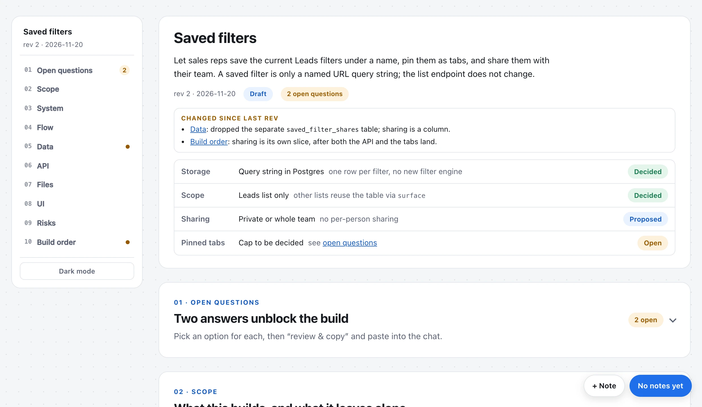
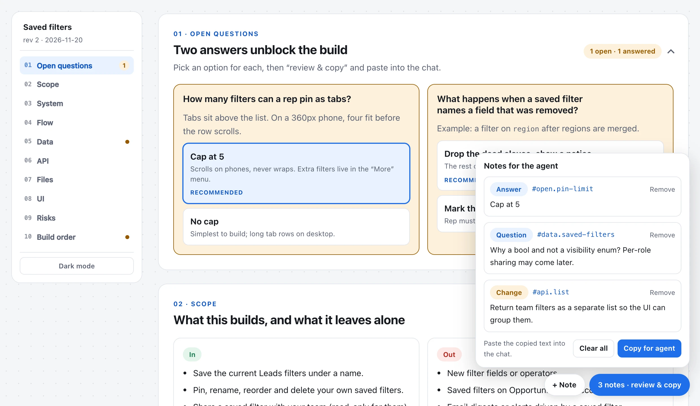
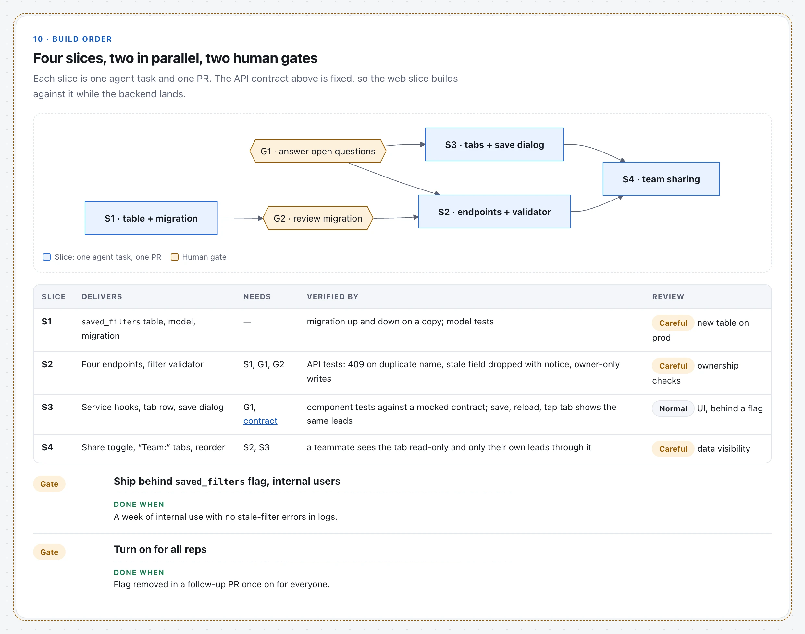
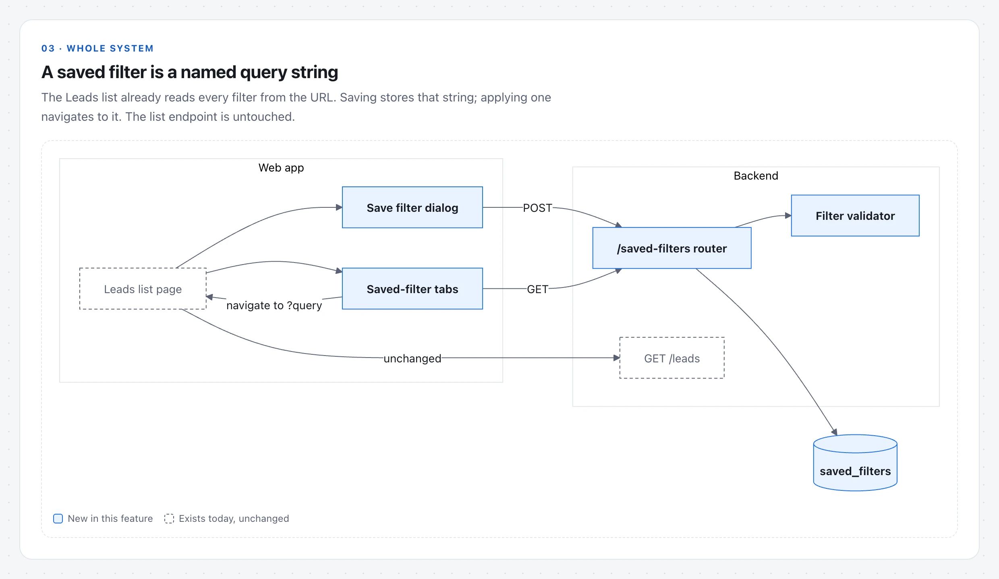

# whiteboard

An agent skill that turns a feature idea into an interactive design page before any code is written. Devs review it in minutes, tag anything with a question or a change, and the page becomes the spec.

<picture>
  <source media="(prefers-color-scheme: dark)" srcset="docs/images/overview-dark.webp">
  
</picture>

## Install

In Claude Code:

```
/plugin marketplace add Uttsavv/whiteboard-skill
/plugin install whiteboard@whiteboard-skill
```

Other agents: `npx skills add Uttsavv/whiteboard-skill`

## Use

```
whiteboard the saved-filters feature
```

The agent reads the code the feature touches and opens a page with the scope, architecture, flows, schema, APIs, wireframes and build order. If your app has a design system, the page uses it.

## Where it fits

```
idea / issue ──► whiteboard ──► review loop ──► tickets ──► agents build ──► PR review
                 (the design)   (tag, paste,    (one per    (one slice      (against the
                                 revise)         slice)      per PR)         whiteboard)
```

**Use it** for anything that crosses layers, adds a table or an API, or has a decision you'd want to see before the code: new features, migrations, cross-team changes.

**Skip it** for bug fixes, one-file changes and copy tweaks. A plain prompt is faster.

## Review it

Hover any card, row or diagram node and press its tag, or press `N` and click. Leave a question, a change or a "looks good". Pick an option on each open question. Then **review & copy** and paste the notes into the chat. The agent revises the page and marks what changed.

<picture>
  <source media="(prefers-color-scheme: dark)" srcset="docs/images/feedback-dark.webp">
  
</picture>

## Built for agents to implement

The plan has no week estimates. It cuts the work into slices, one agent task and one PR each, shows which run in parallel, how each is verified, and where a human has to decide or review.

<picture>
  <source media="(prefers-color-scheme: dark)" srcset="docs/images/build-order-dark.webp">
  
</picture>

Diagrams mark what is new against what exists today:

<picture>
  <source media="(prefers-color-scheme: dark)" srcset="docs/images/system-dark.webp">
  
</picture>

## Details

- One self-contained HTML file, no server. Diagrams load Mermaid from a CDN.
- Clean by default: one accent, flat colours, light and dark themes. No gradients, purple or decorative stripes unless your design system has them.
- Try the example: `python3 skills/whiteboard/scripts/build.py skills/whiteboard/example`, then open `skills/whiteboard/example/index.html`.
- Regenerate these images: `node scripts/screenshots.mjs`.

MIT licensed.
